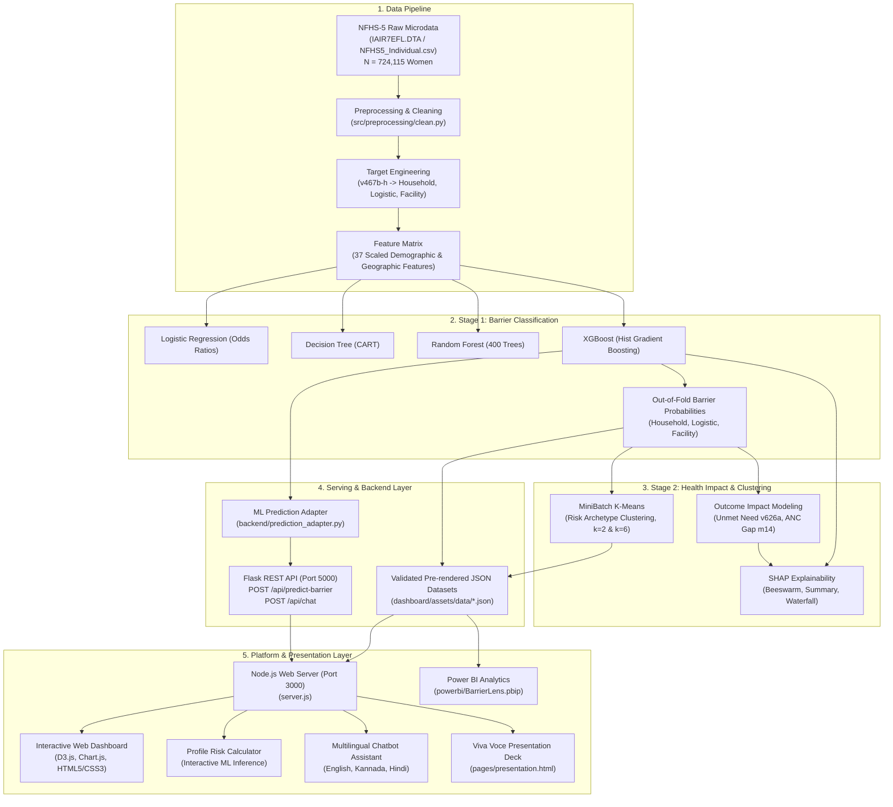
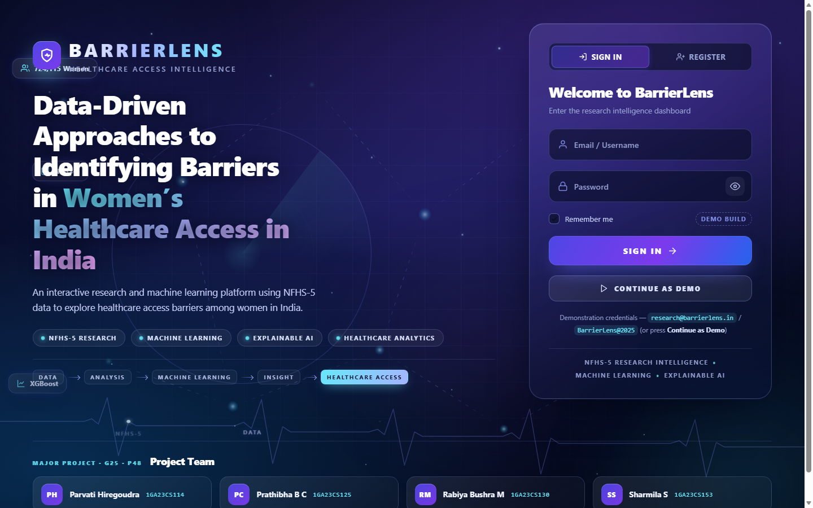
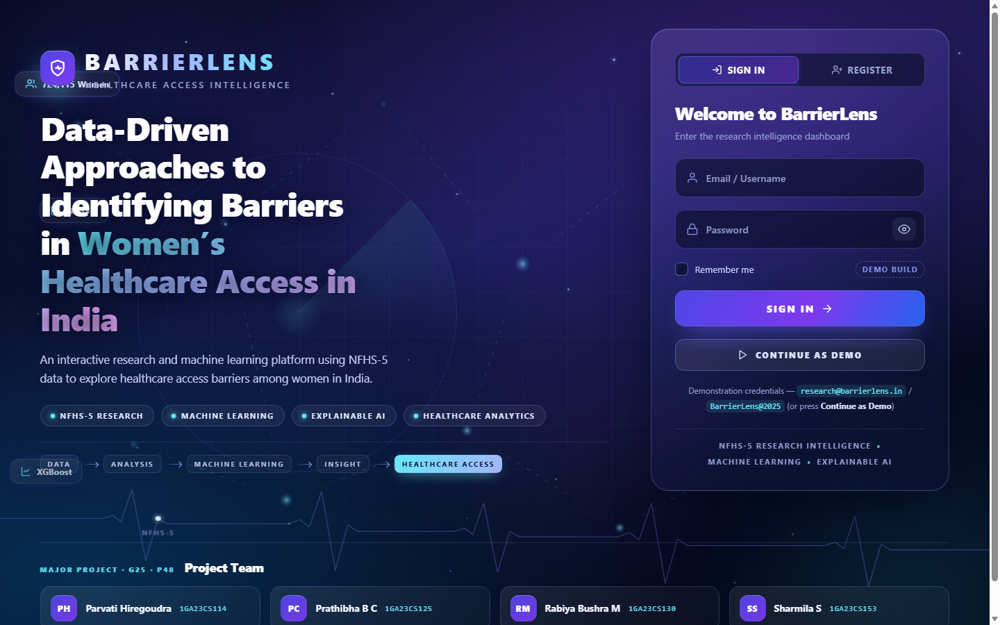
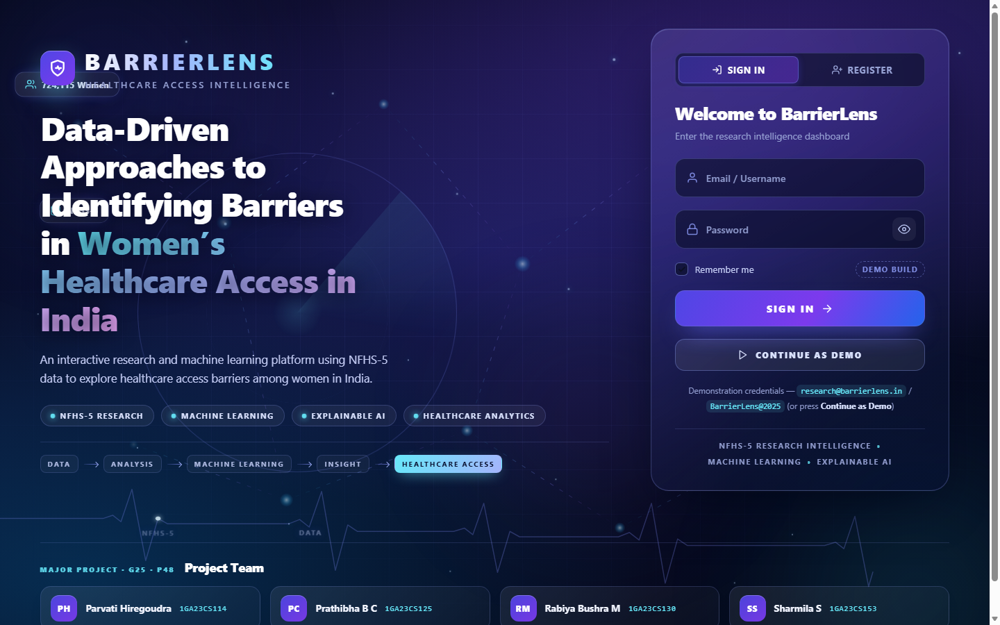
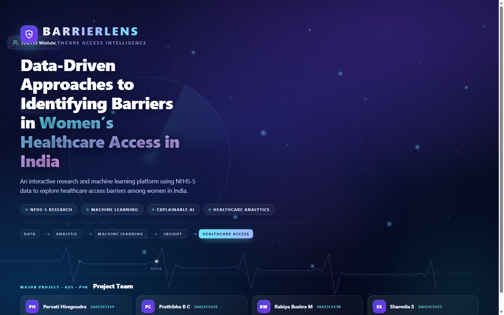
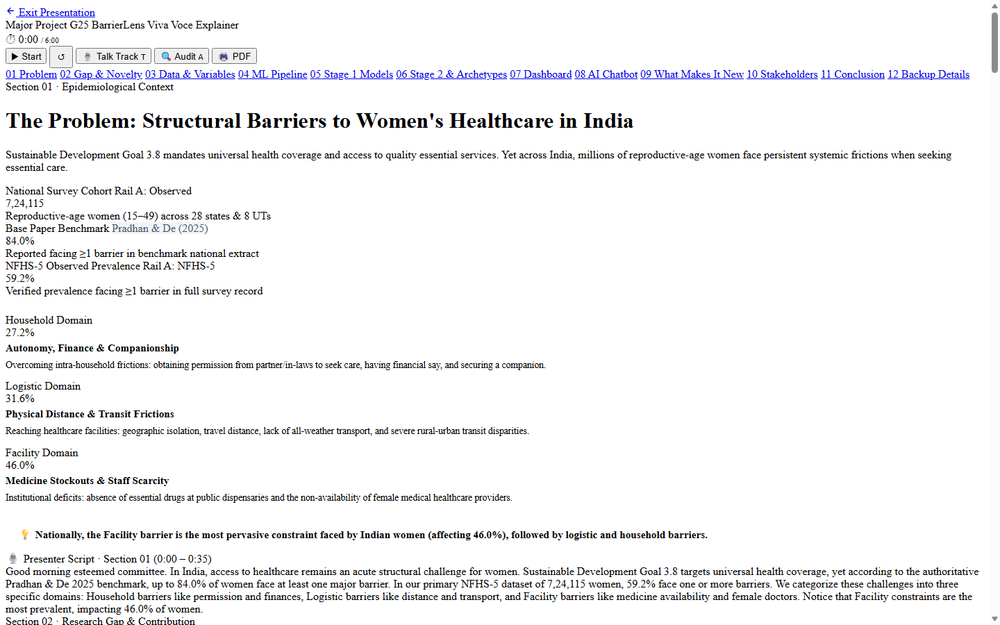
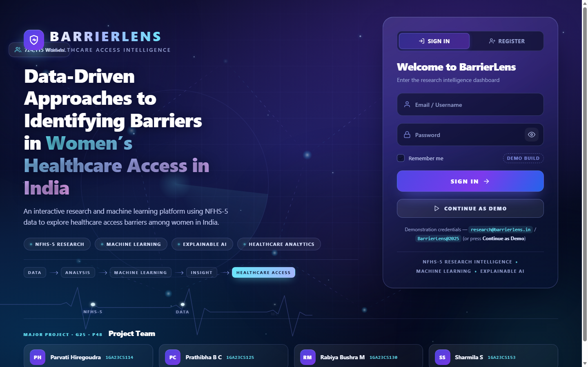

# BarrierLens: Women's Healthcare Access Research Platform (WHCARP)

[](https://www.python.org/)
[](https://nodejs.org/)
[-orange.svg)](https://dhsprogram.com/)
[-purple.svg)]()

> **BarrierLens** is an end-to-end machine learning research platform and decision-support dashboard designed to identify, predict, and interpret sociodemographic barriers to women's healthcare access across India. Grounded in the National Family Health Survey (NFHS-5, 2019–21) individual-level dataset of **724,115 women**, the platform models three core barrier domains, estimates downstream health outcome impacts, clusters vulnerability archetypes, and provides an explainable AI dashboard paired with a stateful, multilingual research assistant.

---

## Table of Contents

1. [Project Overview](#1-project-overview)
2. [Problem Statement and Motivation](#2-problem-statement-and-motivation)
3. [Project Objectives](#3-project-objectives)
4. [Key Features](#4-key-features)
5. [System Architecture](#5-system-architecture)
6. [Technology Stack](#6-technology-stack)
7. [Dataset Information](#7-dataset-information)
8. [Machine Learning Methodology](#8-machine-learning-methodology)
9. [Application Screenshots](#9-application-screenshots)
10. [Project Structure](#10-project-structure)
11. [Installation and Execution Instructions](#11-installation-and-execution-instructions)
12. [Research Contribution](#12-research-contribution)
13. [Team and Acknowledgements](#13-team-and-acknowledgements)
14. [References](#14-references)

---

## 1. Project Overview

Access to timely healthcare is a fundamental human right, yet millions of Indian women face compounded structural, financial, and geographic impediments. **BarrierLens** (Major Project Group 25, Project ID: P48) develops an empirical, individual-level machine learning framework grounded in the microdata of India's fifth National Family Health Survey (NFHS-5). 

Replicating and significantly expanding upon the landmark benchmark by **Pradhan & De (2025, *BMC Health Services Research*)**, BarrierLens transitions from traditional aggregate district-level indicators to **724,115 individual women records**. The system couples a two-stage machine learning pipeline (Stage 1 barrier classification across 4 models; Stage 2 health outcome impact modeling & K-Means risk clustering) with game-theoretic interpretability (SHAP), a client-side analytics web dashboard, Power BI semantic models, and a grounded conversational research assistant.

---

## 2. Problem Statement and Motivation

In low- and middle-income countries, aggregate regional metrics often obscure the severe intersectional disparities faced by women at the household level. While national surveys like NFHS-5 collect detailed responses on reasons for not seeking medical advice (e.g., getting permission, obtaining money, distance to health facilities, concern about no female health providers), health policy research frequently aggregates these variables into district averages.

**Core Research Limitations Addressed:**
1. **Loss of Intersectional Granularity:** District averages mask severe intra-district heterogeneity where wealth, caste, maternal education, and parity intersect.
2. **Binary Oversimplification:** Women rarely face an isolated obstacle; barriers are compounded across household autonomy, transport logistics, and facility readiness.
3. **Black-Box Decision Support:** Clinical and policy stakeholders require interpretable, factor-level explanations (Odds Ratios and SHAP values) rather than opaque predictions.
4. **Lack of Actionable Translation:** Machine learning research models are seldom bridged to interactive, user-facing policy calculators or multilingual community guidance tools.

BarrierLens addresses these gaps by evaluating individual-level barrier classifications, quantifying their downstream effects on unmet family planning and antenatal care gaps, and deploying the results through an accessible platform.

---

## 3. Project Objectives

- **Individual-Level Barrier Classification (Stage 1):** Construct and evaluate predictive models across three distinct healthcare access barrier domains:
  - *Household Barriers* (permission to visit, financial autonomy)
  - *Logistic Barriers* (distance to healthcare facility, transport availability)
  - *Facility-Level Barriers* (absence of female health providers, concern over drug/equipment availability)
- **Downstream Outcome Impact Modeling (Stage 2):** Quantify the empirical uplift of barrier burden on secondary health outcomes:
  - Unmet Need for Family Planning (`target_unmet_fp`, NFHS-5 code `v626a`)
  - Antenatal Care Access Gap (`target_anc_gap`, $< 4$ visits during pregnancy, NFHS-5 code `m14`)
- **Vulnerability Archetype Profiling:** Cluster individuals into distinct vulnerability archetypes using unsupervised MiniBatch K-Means on out-of-fold risk probabilities.
- **Model Explainability & Factor Grounding:** Apply SHAP (SHapley Additive exPlanations) and Logistic Regression Odds Ratios ($e^\beta$) to identify primary risk and protective drivers.
- **Interactive Decision-Support Platform:** Deliver an interactive D3.js/Chart.js web dashboard, Power BI reporting project, and an evidence-grounded multilingual research assistant.

---

## 4. Key Features

- **Dual-Rail Verification System:** Direct benchmark comparison between observed NFHS-5 survey statistics (Rail A) and out-of-fold machine learning predictions (Rail B).
- **Profile Risk Calculator:** An interactive 9-point sociodemographic assessment tool generating real-time risk probabilities for all three barrier domains with actionable factor insights.
- **State & Regional Disparity Explorer:** Interactive choropleth mapping across 36 Indian States and Union Territories with sortable state rankings and inequality multipliers.
- **Sociodemographic Stratification:** Granular breakdown across wealth quintiles (Poorest to Richest), education tiers, social categories, marital status, and rural-urban geography.
- **Risk Archetype Clustering:** Segmentation into distinct vulnerability profiles to support targeted maternal health interventions.
- **Model Explainability Hub:** Global beeswarm plots, mean absolute SHAP importance bars, dependence plots, and individual waterfall attributions.
- **Evidence-Grounded Research Assistant:** A stateful, multi-turn conversational assistant with Ollama LLM integration, strict non-causal safety validators, domain URL allow-listing, and trilingual support (**English, Kannada, Hindi**).
- **Power BI Integration:** Fully scripted PBIP semantic model (`BarrierLens.pbip`) featuring TMDL table definitions, standardized DAX measures, and interactive report pages.

---

## 5. System Architecture



---

## 6. Technology Stack

| Layer | Technologies & Libraries |
| :--- | :--- |
| **Data & Core ML** | Python 3.8+, Pandas 2.0+, NumPy 1.24+, Scikit-Learn 1.3+, Imbalanced-Learn 0.11+, Joblib |
| **Gradient Boosting** | XGBoost 1.7+ (`tree_method='hist'`, balanced scale pos weights) |
| **Model Interpretability** | SHAP 0.43+ (TreeExplainer, LinearExplainer), Matplotlib 3.7+, Seaborn 0.12+ |
| **Web Server & Gateway** | Node.js (Built-in HTTP, Zero external NPM dependencies) |
| **Backend REST API** | Flask 3.0+, Flask-CORS 4.0+, Python-Dotenv 1.0+ |
| **Conversational Intelligence**| Ollama API (`llama3.2`), Rule-based deterministic fallbacks, Web Speech API |
| **Frontend Platform** | Vanilla JavaScript (ES6+), D3.js v7, Chart.js, Plotly 2.35+, HTML5, CSS3 Modern Grid |
| **Business Intelligence** | Microsoft Power BI Desktop, Tabular Model Definition Language (TMDL), DAX |
| **Automated Testing** | Pytest 8.4+, Node.js Test Harness, In-Memory API Client |

---

## 7. Dataset Information

Due to file size restrictions, the complete raw microdata is securely hosted on Google Drive.

> [!IMPORTANT]
> **Primary Dataset Access Link (Google Drive):**  
> 🔗 [https://drive.google.com/drive/folders/1npQ_5hbFtR-NNh3OvlpND81OdFNjMHLa?usp=sharing](https://drive.google.com/drive/folders/1npQ_5hbFtR-NNh3OvlpND81OdFNjMHLa?usp=sharing)  
> *(Placeholder link — to be updated upon final institutional drive allocation).*

### Dataset Specifications

- **Source:** Demographic and Health Surveys (DHS) Program / Ministry of Health and Family Welfare (MoHFW), Government of India.
- **Survey Round:** National Family Health Survey (NFHS-5, 2019–2021).
- **Target Population:** Women aged 15–49 across 28 States and 8 Union Territories.
- **Total Analytic Sample Size:** **$N = 724,115$ women** (zero missingness in the barrier module).
- **Files Available:**
  1. `NFHS5_Individual.csv`: Pre-extracted research CSV containing 35 individual-level variables (~215 MB).
  2. `IAIR7EFL.DTA`: Full India Women's Individual Recode in Stata format (~5.19 GB).

### Expected Dataset Location

To run the complete data processing or model retraining pipelines, download `NFHS5_Individual.csv` and place it in the project repository as follows:

```
BarrierLens_MP_G25_P48/
└── data/
    └── raw/
        ├── .gitkeep
        └── NFHS5_Individual.csv    <-- [Place downloaded file here]
```

---

## 8. Machine Learning Methodology

### Stage 1: Individual-Level Barrier Classification

Target variables are constructed from the NFHS-5 medical treatment question items (`v467b` through `v467i`):
- **Household Barrier (`target_household`):** Positive if obtaining permission (`v467b`) or getting money for treatment (`v467c`) is a big problem (Prevalence: **27.16%**; $N_{\text{pos}} = 196,654$).
- **Logistic Barrier (`target_logistic`):** Positive if distance to health facility (`v467d`) or finding transport (`v467e`) is a big problem (Prevalence: **31.61%**; $N_{\text{pos}} = 228,867$).
- **Facility Barrier (`target_facility`):** Positive if concern over no female provider (`v467g`) or no drugs available (`v467h`) is a big problem (Prevalence: **46.01%**; $N_{\text{pos}} = 333,184$).
- **Composite Any Barrier:** Positive if facing at least one barrier domain (Prevalence: **59.16%**; $N_{\text{pos}} = 428,382$).

#### Stage 1 Benchmark Performance (80/20 Stratified Hold-Out Evaluation)

| Target Barrier | Model | ROC-AUC | Test Accuracy | Precision | Recall | F1-Score |
| :--- | :--- | :---: | :---: | :---: | :---: | :---: |
| **Household Barrier** | **XGBoost** | **0.6625** | **0.7307** | 0.5283 | 0.0465 | 0.0855 |
| | Random Forest | 0.6613 | 0.6039 | 0.3541 | 0.6997 | 0.4704 |
| | Logistic Regression | 0.6586 | 0.7298 | 0.5113 | 0.0305 | 0.0577 |
| | Decision Tree | 0.6511 | 0.7305 | 0.5367 | 0.0332 | 0.0623 |
| **Logistic Barrier** | **XGBoost** | **0.6650** | **0.6914** | 0.5398 | 0.1047 | 0.1752 |
| | Random Forest | 0.6630 | 0.6029 | 0.4101 | 0.6789 | 0.5114 |
| | Logistic Regression | 0.6603 | 0.6896 | 0.5204 | 0.0970 | 0.1635 |
| | Decision Tree | 0.6566 | 0.6897 | 0.5218 | 0.0792 | 0.1370 |
| **Facility Barrier** | **XGBoost** | **0.6188** | **0.5864** | 0.5595 | 0.4407 | 0.4930 |
| | Random Forest | 0.6170 | 0.5811 | 0.5463 | 0.5919 | 0.5682 |
| | Logistic Regression | 0.6112 | 0.5819 | 0.5528 | 0.4406 | 0.4904 |
| | Decision Tree | 0.6058 | 0.5809 | 0.5487 | 0.4791 | 0.5115 |

### Stage 2: Health Outcome Modeling & Unsupervised Clustering

- **Vulnerability Archetypes:** Unsupervised MiniBatch K-Means fitted on standardized out-of-fold barrier probabilities:
  - *Cluster 0 (High Overall Vulnerability):* Elevated probabilities across all three domains; concentrated among rural, uneducated, and lowest wealth quintile respondents.
  - *Cluster 1 (Low Structural Vulnerability):* Reduced baseline risk; predominantly urban, literate, and higher wealth tiers.
- **Secondary Health Outcomes:**
  - *Unmet Need for Family Planning (`target_unmet_fp`):* Modeled using Stage 1 out-of-fold probabilities; reveals significant uplift among women experiencing facility and logistic barriers.
  - *Antenatal Care Access Gap (`target_anc_gap`):* Evaluated on pregnant/post-partum women subset ($N = 163,018$), identifying distance and financial disempowerment as dominant inhibitors.

---

## 9. Application Screenshots

The running BarrierLens research platform provides specialized decision-support interfaces:

### 1. Main Dashboard & Architecture Overview

*Figure 9.1: BarrierLens Dashboard Home displaying national headline KPIs, domain navigation, and architectural summaries.*

---

### 2. National Overview & Three Barrier Domains

*Figure 9.2: National breakdown contrasting observed NFHS-5 survey statistics against Stage 1 machine learning predictions across Household (27.16%), Logistic (31.61%), and Facility (46.01%) barriers.*

---

### 3. State-Level Geographic Disparities

*Figure 9.3: State Disparities view with interactive choropleth heatmaps, top/bottom ranking tables, and inter-state inequality multipliers (e.g., Karnataka vs. Kerala).*

---

### 4. Rural-Urban Divide Analysis

*Figure 9.4: Rural-Urban disparity explorer illustrating rural barrier amplification (63.49% rural vs. 46.03% urban any-barrier prevalence).*

---

### 5. Sociodemographic Stratification

*Figure 9.5: Intersectional sociodemographic breakdown across wealth quintiles (Poorest to Richest), maternal education, and social categories.*

---

### 6. Vulnerability Archetypes & Risk Clustering

*Figure 9.6: Unsupervised K-Means clustering isolating multi-dimensional risk profiles and archetype characteristics.*

---

### 7. Explainability & SHAP Attributions

*Figure 9.7: Interpretability hub featuring global SHAP beeswarm distributions, mean absolute impact bars, and feature importance rankings.*

---

### 8. Profile Risk Calculator (Interactive Inference)

*Figure 9.8: Profile Risk Calculator allowing researchers to input sociodemographic parameters and generate instant predicted barrier risks via the Flask ML adapter.*

---

### 9. Base Paper Replication & Benchmark

*Figure 9.9: Comparative evaluation benchmarking BarrierLens individual-level results against Pradhan & De (2025) baseline figures.*

---

### 10. Research Assistant Chatbot

*Figure 9.10: Stateful research assistant featuring dual inquiry modes, non-causal safety validators, and evidence citation.*

---

### 11. Viva Voce Presentation Deck

*Figure 9.11: Integrated Viva Voce explainer deck featuring a 6-minute presentation timer, slide navigation, and live runtime audit drawer.*

---

### 12. Authentication & Demonstration Gate

*Figure 9.12: Academic evaluation login portal with preconfigured demo researcher profiles and quick-access shortcuts.*

---

## 10. Project Structure

```
BarrierLens_MP_G25_P48/
├── assets/                               # Shared supplementary asset data
│   └── data/                             # Registry mappings
├── backend/                              # Python Flask ML & Chatbot Service
│   ├── config/                           # Environment & service configurations
│   ├── routes/                           # API Blueprints (predict.py, chat.py)
│   ├── services/                         # Ollama service, safety validator, prompt service
│   ├── app.py                            # Flask application entry point
│   ├── prediction_adapter.py             # Deterministic XGBoost inference adapter
│   └── requirements.txt                  # Backend-specific Python dependencies
├── dashboard/                            # Interactive Web Platform
│   ├── assets/                           # CSS styles, pre-rendered JSON data, JS modules
│   │   ├── css/                          # Modern responsive stylesheets
│   │   ├── data/                         # 12 Verified pre-computed analytical datasets
│   │   ├── images/                       # UI icons and model publication plots
│   │   └── js/                           # Engines (evidence, context, NLU, chatbot, speech)
│   ├── pages/                            # Modular analytical dashboard subpages
│   ├── index.html                        # Main Dashboard Home
│   ├── login.html                        # Academic demonstration login portal
│   └── presentation.html                 # Presentation deck redirect entry
├── data/                                 # Datasets (gitignored for large files)
│   ├── dashboard/                        # Pre-aggregated Power BI CSV feeds
│   ├── processed/                        # Feature matrices (X_features.csv, OOF probabilities)
│   └── raw/                              # NFHS5_Individual.csv, IAIR7EFL.DTA
├── docs/                                 # Project documentation & guides
│   ├── screenshots/                      # 12 Full-fidelity running application captures
│   └── *.md, *.docx, *.pdf               # Verification reports & implementation specifications
├── models/                               # Frozen Stage 1 XGBoost model binaries
│   ├── xgb_facility.pkl                  # Facility barrier model
│   ├── xgb_household.pkl                 # Household barrier model
│   └── xgb_logistic.pkl                  # Logistic barrier model
├── notebooks/                            # Reproducible research Jupyter notebooks (00 to 12)
├── plots/                                # Publication-ready figures & forest plots
├── powerbi/                              # Power BI Project (PBIP)
│   ├── BarrierLens.Report/               # Report layout and registered visual resources
│   ├── BarrierLens.SemanticModel/        # TMDL table definitions, cultures, DAX measures
│   └── BarrierLens.pbip                  # Power BI Desktop entry point
├── reports/                              # Generated research chapters & modeling reports
├── saved_models/                         # Stage 1 & Stage 2 model checkpoints
├── scripts/                              # Automated pipeline utilities & data builders
├── src/                                  # Modular source library
│   ├── clustering/                       # K-Means clustering implementations
│   ├── dashboard/                        # Aggregations, pipeline constants, labels
│   ├── evaluation/                       # Authoritative field dictionary, metrics, plots
│   ├── models/                           # Model trainers (LR, DT, RF, XGB)
│   ├── preprocessing/                    # Clean, encode, engineer features, scale
│   └── shap_analysis/                    # SHAP explainability pipelines
├── tests/                                # Automated test suite (Pytest & Node.js)
│   ├── backend/                          # Backend Flask API & safety tests
│   ├── chatbot/                          # 14 Comprehensive chatbot workflow suites
│   ├── test_e2e_member2_integration.py   # Full cross-component E2E integration test
│   └── test_member2_prediction_adapter.py# ML prediction adapter unit tests
├── .env.example                          # Environment variable template
├── .gitignore                            # Clean Git exclusion rules
├── package.json                          # Node.js project manifest & scripts
├── pytest.ini                            # Pytest configuration
├── requirements.txt                      # Comprehensive root Python dependencies
├── server.js                             # Zero-dependency Node.js HTTP server & API gateway
├── start_project.bat                     # Windows one-click project launcher
└── start_project.ps1                     # PowerShell automated project launcher
```

---

## 11. Installation and Execution Instructions

### Prerequisites

- **Python 3.8+** (Python 3.10–3.13 tested and verified)
- **Node.js 16+** (uses standard runtime libraries)
- *(Optional)* **Ollama** running locally on port 11434 with `llama3.2` for offline conversational generation.

### Step 1: Environment Setup

Clone the repository and install the comprehensive Python dependencies:

```bash
# Navigate to project root
cd BarrierLens_MP_G25_P48

# Create and activate a virtual environment (optional but recommended)
python -m venv venv
# Windows:
venv\Scripts\activate
# Linux/macOS:
source venv/bin/activate

# Install all required Python packages
pip install -r requirements.txt
```

### Step 2: Dataset Placement

Download the analytic dataset (`NFHS5_Individual.csv`) from the [Google Drive repository](https://drive.google.com/drive/folders/1npQ_5hbFtR-NNh3OvlpND81OdFNjMHLa?usp=sharing) and place it under `data/raw/`:

```bash
# Verify dataset placement
python -c "import os; print('Found dataset:', os.path.exists('data/raw/NFHS5_Individual.csv'))"
```

### Step 3: Launching the Application

You can start the complete full-stack environment using the automated launcher scripts:

#### Windows Automated Launch:
```cmd
# Double-click start_project.bat or run in PowerShell:
.\start_project.ps1
```

#### Manual Startup:

1. **Start the Flask Backend API (Port 5000):**
   ```bash
   python backend/app.py
   ```
2. **Start the Web Dashboard Server (Port 3000):**
   ```bash
   node server.js
   ```
3. Open your browser to `http://localhost:3000/login.html` (or `http://localhost:3000/` if authentication is bypassed via `BL_DISABLE_AUTH=1`).

### Demonstration Credentials

| Role / Profile | Username / Identifier | Password | Access Scope |
| :--- | :--- | :--- | :--- |
| **Research Lead** | `research@barrierlens.in` | `BarrierLens@2025` | Full Dashboard & Export Privileges |
| **Demo Shortcut** | `demo` | `demo1234` | Full Demo Mode (or click *Continue as Demo*) |
| **Member 1 (1GA23CS114)** | `1ga23cs114` | `BarrierLens@2025` | Team Member Portal |
| **Member 2 (1GA23CS125)** | `1ga23cs125` | `BarrierLens@2025` | Team Member Portal |
| **Member 3 (1GA23CS130)** | `1ga23cs130` | `BarrierLens@2025` | Team Member Portal |
| **Member 4 (1GA23CS153)** | `1ga23cs153` | `BarrierLens@2025` | Team Member Portal |

### Running the Test Suites

Execute the comprehensive automated verification suites across both Python and Node.js environments:

```bash
# 1. Run Python unit & E2E integration tests:
python -m pytest tests/test_member2_prediction_adapter.py tests/test_e2e_member2_integration.py tests/backend/test_chat_backend.py

# 2. Run Chatbot JavaScript test suites:
npm test
```

---

## 12. Research Contribution

1. **Individual-Level Scalability:** Transcends ecological fallacy constraints inherent in district averages by training on $N = 724,115$ women, capturing subtle compound barrier interactions.
2. **Benchmark Verification:** Provides a rigorous replication of Pradhan & De (2025) while explaining structural divergence resulting from sample size expansion ($108,785$ ever-married women vs. full $724,115$ women).
3. **Actionable Vulnerability Archetyping:** Translates multi-label barrier probabilities into distinct, intuitive vulnerability clusters for health administrators.
4. **Guardrailed Scientific Conversational AI:** Demonstrates a zero-hallucination medical NLP architecture strictly tethering generative LLMs to verified JSON microdata, complete with non-causal language sanitization and automated disclaimers.

---

## 13. Team and Acknowledgements

### Major Project Group 25 (P48)

*Department of Computer Science and Engineering*

- **Parvati Hiregoudra** (`1GA23CS114`) — Random Forest Classifiers, SHAP Explainability & Voice/UI Integration
- **Prathibha B C** (`1GA23CS125`) — Risk Archetype Clustering (K-Means), Multi-Output Logistic Regression & Full Architecture
- **Rabiya Bushra M** (`1GA23CS130`) — Data Integration Pipeline, Shared Evaluation Framework & Flask REST API
- **Sharmila S** (`1GA23CS153`) — XGBoost Gradient Boosting, Model Results Evaluation & Implementation Reporting

### Acknowledgements

We express our gratitude to our project guide, faculty coordinators, and the Department of Computer Science & Engineering for their continuous mentorship. We also acknowledge the **International Institute for Population Sciences (IIPS)** and **The DHS Program** for granting open scientific access to the NFHS-5 microdata.

---

## 14. References

1. **Pradhan, M. R., & De, A. (2025).** *Women’s healthcare access in India: identifying barriers and sociodemographic disparities using NFHS-5 data.* BMC Health Services Research, 25(1), 323. [https://doi.org/10.1186/s12913-025-12470-3](https://doi.org/10.1186/s12913-025-12470-3)
2. **International Institute for Population Sciences (IIPS) and ICF. (2021).** *National Family Health Survey (NFHS-5), 2019-21: India Report.* Mumbai: IIPS.
3. **Lundberg, S. M., & Lee, S. I. (2017).** *A unified approach to interpreting model predictions.* Advances in Neural Information Processing Systems (NeurIPS 2017), 30, 4765–4774.
4. **Chen, T., & Guestrin, C. (2016).** *XGBoost: A scalable tree boosting system.* Proceedings of the 22nd ACM SIGKDD International Conference on Knowledge Discovery and Data Mining, 785–794.
5. **Breiman, L. (2001).** *Random Forests.* Machine Learning, 45(1), 5–32.
